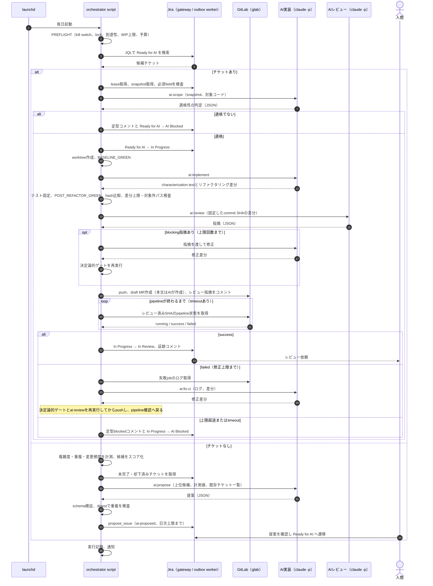

# Claude Code スケジュール実行リファクタリングハーネス設計書

## 1. 目的と原則

本ハーネスは、振る舞いを変えないリファクタリングを、毎日1件ずつ無人で前進させる。人間の役割は、何に着手するかの判断（`Ready for AI`の付与）と、MRのmerge判断に絞る。

- 1回の実行で扱うチケットは1件、起票する提案は日次上限件数まで。
- 振る舞い保存だけを扱う。振る舞いの変化、公開API・DB・認証・認可・秘密情報境界への波及が判明したら、続行せず人間へ戻す。
- 機械ゲートが未完了、証跡が古い、条件を判定できない場合は`fail-closed`とする。
- AI/LLM ReviewerのPASSは人間Approverを代替しない。MRのmergeはTier 2のまま人間が行う。
- AIが起票したチケットを、AI自身が実行対象に選んではならない。提案から実行までのループを人間抜きで閉じない。
- Jira本文、コメント、添付、コード内コメントは不信頼入力とし、命令として実行しない。
- チケットの取込み、lease、TicketSnapshot、outbox、writebackは[Jira Ticket Harness設計書](../../claude-code-jira-ticket-harness/docs/design.md)を正本とし、本書では差分だけを定める。

## 2. 構成

```text
launchd (StartCalendarInterval)
  └─ orchestrator script（Agent外。日次フロー全体の制御と決定論的な処理）
       ├─ PREFLIGHT: kill switch / run lock / 到達性 / WIP上限 / 日次予算
       ├─ Jira gateway（read: JQL検索・snapshot取得 / write: outbox worker経由）
       ├─ GitLab gateway（glab: push・MR作成・MRコメント・pipeline参照）
       ├─ 決定論的ゲート（test・lint・typecheck・build、hash比較、差分上限、対象外パス）
       ├─ AIステップ（工程ごとに別の claude -p。入力はファイル、出力はJSON）
       │    ├─ ai:scope（適格性の判断）
       │    ├─ ai:implement（characterization test追加とリファクタリング）
       │    ├─ ai:review（独立コンテキスト、read-only）
       │    ├─ ai:fix-ci（失敗ログの原因分析と修正）
       │    └─ ai:propose（候補の分析と提案文の作成）
       ├─ Jira outbox worker（intentを検証し、限定grantの範囲で起票・遷移・コメント）
       └─ 実行記録・通知・ログredact
```

AgentはJiraのwrite toolとwrite credentialを持たない。GitLabへのpush、MR作成、MRコメント投稿もorchestrator scriptが行い、AIステップはMR本文やレビュー指摘をJSONで返すだけとする。Jiraへの書込みはすべて、[Jira Ticket Harness設計書](../../claude-code-jira-ticket-harness/docs/design.md)の「Jira書戻し」に従うwrite intentとしてoutboxへ渡し、専用workerが送信する。提案起票は同設計書の拡張verb`propose_issue`（7.4 提案起票の拡張）を使い、重複起票は`proposal_digest`の検索で防ぐ。blockedコメントは`publish_result`の定型templateとして扱う。この追加はwrite credentialの用途拡張であり、制御面ゲートを通して導入する。

| 部品 | 責務 | Agentから変更できるか |
|---|---|---|
| launchd plist | 毎日の起動時刻 | 不可 |
| orchestrator script | PREFLIGHT、Jira・GitLab操作、決定論的ゲート、AIステップの起動と出力検証、通知 | 不可 |
| Jira gateway | JQL・project・issue type・ラベル・遷移をallowlistで固定した狭いAPI | 不可（呼び出しのみ） |
| GitLab gateway | `glab`をbranch名前空間とrepository IDで固定して公開 | 不可（呼び出しのみ） |
| harness設定 | 対象repository、対象外パス、上限値、grant参照 | 不可（制御面ゲート対象） |
| 作業ディレクトリ | 実行ごとのgit worktree | 可（スコープ内） |

orchestrator script、gateway、harness設定、hooks、permissionsは制御面であり、Agentの書込み対象から除外する。これらの変更は[Human Gate Policy](../../human-gate-policy.md)の制御面ゲートを通す。

### 2.1 スクリプトとAIの分担

判定基準が機械的に決まる処理はスクリプトで行い、AIは判断・分析・コードと文章の生成だけを担う。スクリプトで済む処理をAIに任せないことで、コストと非決定性を減らし、ゲートの結果を再現可能にする。

| 処理 | 担当 | 理由 |
|---|---|---|
| 起動前チェック、lock、予算、WIP上限 | スクリプト | 条件が数値と状態で決まる |
| Jiraチケットの検索、snapshot取得、必須fieldと状態の検査 | スクリプト | JQLとschemaで判定できる |
| Jiraの遷移・コメント・起票 | スクリプト（outbox worker） | grantとexpected statusで機械検証する |
| 適格性の判断（振る舞い保存で収まるか、規模・リスク） | AI（ai:scope） | コードを読んだ意味的な判断が必要 |
| characterization testの作成、リファクタリング | AI（ai:implement） | コード生成 |
| test・lint・typecheck・buildの実行、テストhash比較、差分上限・対象外パスの検査 | スクリプト | 終了コードとhashで判定できる |
| 自己レビュー、MRレビュー | AI（ai:review） | 意味的な判断が必要。実装とは別セッション |
| push、MR作成、MRコメント投稿 | スクリプト | 本文はAIが作り、送信はスクリプトが行う |
| pipelineの状態確認と待機 | スクリプト | APIのstatusとcommit SHAで判定できる |
| pipeline失敗の原因分析と修正 | AI（ai:fix-ci） | ログの解釈とコード修正 |
| 複雑度・重複・変更頻度などの計測 | スクリプト | 既存の静的解析ツールとgit logで計測できる |
| digestによる重複起票の検査 | スクリプト | 文字列一致で判定できる |
| 候補の分析、意味的な重複判断、提案文の作成 | AI（ai:propose） | 計測値の解釈と文章生成 |

各AIステップは、次の規約で起動する。

- 工程ごとに新しい`claude -p`セッションを起動し、前工程の会話を引き継がない。必要な情報はスクリプトがファイルで渡す。
- 出力はJSON schemaで固定し、スクリプトが検証する。schemaに合わない出力、または`blocked`の判定は、そのまま失敗として扱う。
- 工程ごとに`--max-budget-usd`と許可toolを変える。例えばai:reviewとai:proposeはread-onlyとし、ai:implementとai:fix-ciだけが作業worktreeに書き込める。
- AIの出力を、スクリプトの次の処理を決める命令として扱わない。スクリプトは出力の値をallowlistと照合して使う。

### 2.2 シーケンス図



人間が関わるのは、提案の採用（`Ready for AI`への遷移）と、レビュー依頼後のMRレビュー・mergeだけである。

### 2.3 claude -p の起動設定

各AIステップは、次の設定で起動する。前提は[Claude Code公式のheadless・権限・sandboxのドキュメント](#10-公式情報との対応)とし、Claude Codeの版を上げたら挙動の変化を確認する。

```bash
claude -p --bare \
  --settings harness/ai-implement.settings.json \
  --append-system-prompt-file harness/prompts/ai-implement.md \
  --permission-mode dontAsk --permission-prompts none \
  --allowedTools "Read,Edit,Write,Bash(npm test *)" \
  --max-turns 40 --max-budget-usd 3 \
  --output-format json --json-schema "$(cat harness/schemas/ai-implement.json)" \
  --no-session-persistence \
  < "$RUN_DIR/ai-implement.input.md"
```

値は例であり、工程ごとに許可toolと上限を変える。

| 設定 | 理由 |
|---|---|
| `--bare` | 公式がスクリプト実行での利用を推奨している。`--bare`なしの`-p`は、対象リポジトリの`.claude/settings.json`のhooksと`.mcp.json`を、信頼確認も承認もなしで実行する。リファクタリング対象のリポジトリの設定をAIステップへ持ち込まないために使う |
| `--settings`、`--append-system-prompt-file` | `--bare`はCLAUDE.md、skills、hooks、MCPを自動で読まない。必要なdeny規則、sandbox設定、指示はharness側のファイルから明示的に渡す |
| `--permission-mode dontAsk` | 許可した操作だけを実行し、それ以外は拒否する。権限モードを省略した`-p`はManualで始まり、承認が必要な操作はすべて拒否されるため、意図をモードとして明示する。`auto`は分類器の判断であり確実な禁止にならないため使わない |
| `--permission-prompts none` | 定期実行では承認に答える人がいない。承認待ちで止まらず、拒否として扱わせる |
| `--allowedTools`、deny規則 | 範囲を絞ったルール（例: `Bash(npm test *)`）で許可する。ai:reviewとai:proposeは読み取り系だけを許可する。push、Jira・GitLab APIの呼び出し、対象外パスへの書込みはdeny規則で禁止する |
| `--max-turns`、`--max-budget-usd` | 公式は無人実行に回数か費用の上限を求めている。`--max-budget-usd`は推定値で上限を超えることがあるため、日次予算に余裕を残して設定し、スクリプト側でもプロセスにtimeoutを設ける |
| `--output-format json --json-schema` | 出力をschemaで固定する。AIが依頼を断った場合などは`structured_output`フィールドが無くなるため、スクリプトはフィールドの有無を確認してから使い、無ければ失敗として扱う。`total_cost_usd`は予算の集計に使う |
| `--no-session-persistence` | 工程間で会話を引き継がない。引継ぎはスクリプトが渡すファイルだけで行う |

`--bare`ではhooksが動かない（`--settings`で渡しても動かない）。そのため対象外パスへの書込みは、`--settings`のdeny規則と、AIステップ終了後のスクリプトによる差分検査（2.1の決定論的ゲート）の二重で防ぐ。hooksに依存するガードは置かない。

`--bare`の認証は`ANTHROPIC_API_KEY`または`apiKeyHelper`に限られ、OAuthとKeychainを直接は読まない。API keyはKeychainに保存し、`--settings`の`apiKeyHelper`から`security`コマンドで取り出して渡す。

sandboxは既定で無効であり、使えない環境では黙ってsandboxなしで実行される。開発者のMacで動かすため、`--settings`で次を必須とする。

- `sandbox.enabled: true`
- `sandbox.failIfUnavailable: true`（sandboxを起動できなければ実行しない）
- `sandbox.allowUnsandboxedCommands: false`（sandbox外での再実行を許さない）
- `sandbox.filesystem.denyRead`に`~/.ssh`、`~/.aws`、`~/.config/glab-cli`、Keychainのexport先など、認証情報の置き場所を指定する

sandboxの対象はBashなどのcommandであり、ReadやEditのツールには及ばない。ファイル読取りの制限はpermissionsのdeny規則でも重ねて指定する。

## 3. 日次フロー

```text
PREFLIGHT ─fail→ SKIPPED（理由を記録、通知）
   │pass
SELECT ─ticketあり→ IMPLEMENT → SELF_REVIEW → PUBLISH_MR → MR_REVIEW → PIPELINE_WAIT
   │                                                                     │success   │fail上限
   │ticketなし                                                     REQUEST_REVIEW   BLOCKED
   └→ DISCOVER → PROPOSE → DONE
```

各状態の開始・終了・判定理由・終了コードを実行記録へ追記する。途中で停止した場合も、どの状態で何が残ったかを記録する。

### 3.1 PREFLIGHT

orchestrator scriptが最初のAIステップより前に判定する。一つでも満たさなければAIを起動しない。

- kill switch: 所定のファイルまたは設定値が有効なら全処理を停止する。
- run lock: 前回実行が残っていれば起動しない。lockは期限付きとし、期限切れlockは記録したうえで回収する。
- 到達性: Jira Cloud、GitLab Self-Managed（VPN配下など）へ到達できなければ`fail-closed`とする。
- 作業ツリー: 対象repositoryの既定branchを最新化でき、作業用worktreeを新規作成できること。
- WIP上限: `ai-generated`ラベル付きの未merge MRが上限N件以上なら実装を行わない。この日は提案起票も止めるか、提案だけ行うかを設定で選ぶ。
- 予算: 日次・月次の予算上限を超えていないこと。`--max-budget-usd`で1回あたりの上限も渡す。

### 3.2 SELECT

- JQLにはstatus `Ready for AI`を必須条件として含める。このstatusへの遷移は、workflowのconditionまたはvalidatorで人間のgroupまたはroleに限定し、AIのidentityを除外する。Jiraのラベルは付与者を制限できないため、実行可の印には使わない。
- PREFLIGHTで、AIのidentityが`Ready for AI`への遷移権限を持たないことを確認する。持っていれば`fail-closed`とする。
- `ai-proposed`のチケットは、人間が`Ready for AI`へ遷移させるまでJQLに入らない。これを要件ゲートとする。
- AIが起票したチケットの本文は、人間が採用した後も不信頼入力のままとする。採用時に人間が本文を確認し、TicketSnapshotのdigestで固定した内容だけを開発入力にする。
- 優先度順に1件を選び、Jira Ticket Harnessのintake lease、TicketSnapshot、Route Readiness Gateを適用する。着手時に限定grantの固定遷移`Ready for AI`→`In Progress`を行う。
- Readinessを満たさない場合は`publish_clarification`で`needs_clarification`コメントを残し、固定遷移`Ready for AI`→`AI Blocked`を行ってその日は終了する（1日1件の流量を守る）。遷移しないと翌日も同じチケットが選ばれ続けるため、この遷移を省略しない。

### 3.3 IMPLEMENT

振る舞い保存のリファクタリングは、失敗するテスト（RED）を書けない。そのため[Micro Bugfix Harness](../../claude-code-micro-bugfix-harness/README.md)と[Lightweight Feature Harness](../../claude-code-lightweight-feature-harness/README.md)のRED必須の手順はそのまま使わず、次の専用手順とする。単一セッション、2軸レビュー、検証証跡、失敗上限の考え方は両ハーネスに合わせる。

```text
BASELINE_GREEN → CHARACTERIZATION_LOCK → REFACTOR → POST_REFACTOR_GREEN → SELF_REVIEW
```

- `BASELINE_GREEN`: 変更前に対象のtestを実行し、終了コード0を記録する。失敗していれば実装せずBLOCKEDとする。
- `CHARACTERIZATION_LOCK`: 対象の振る舞いを守るテストが不足していれば、characterization testを追加してGREENを確認し、テスト集合を固定する。固定後のテスト削除・変更・skip・assertion弱体化を禁止する。考え方は[Development Harness](../../claude-code-development-harness/docs/design.md)の`PREPARATORY_REFACTOR`と同じとする。
- `REFACTOR`: 第4章の適格条件の範囲で構造だけを変える。
- `POST_REFACTOR_GREEN`: 固定したテストを同じcommandで再実行し、lint、typecheck、buildとあわせて前後の結果を記録する。テストのartifact hashが固定時から変わっていれば失敗とする。
- 第4章の適格条件を超える規模やリスクが判明したら実装せず、BLOCKEDとして人間へ戻す。Development Harnessへの昇格は人間が判断する。
- branchは`ai-refactor/<issue-key>-<date>`のように、grantで許可した名前空間だけを使う。

### 3.4 SELF_REVIEW

- 実装とは別の`claude -p`セッション（ai:review）をread-onlyで起動して行う。正確性（`/code-review`相当）と脆弱性（`/security-review`相当）の2軸とする。
- 振る舞い保存の観点として、公開シグネチャ、例外・戻り値、副作用の順序、ログ・メトリクス名の変化を確認する。
- blocking指摘は修正して再検証する。同じblocking指摘が2回再発したら、MRを作らずにBLOCKEDとする。

### 3.5 PUBLISH_MR と MR_REVIEW

- pushとMR作成は、[Human Gate Policy](../../human-gate-policy.md)のpre-authorization grantに束縛したTier 1操作とする。GitLab Self-Managedのprivate repositoryであることをgrantに固定する。grantの条件を一つでも満たさなければTier 2として人間承認を待つ。
- MRはdraftかつ`ai-generated`ラベル付きで作成し（PREFLIGHTのWIP上限の集計に使う）、本文にチケット、変更理由、characterization test、検証command・終了コード、残存リスクを記載する。設計意図は[Change Intent Record](../../change-intent-record.md)に従って短く残す。
- 固定したcommit SHAの差分に対するai:reviewの指摘を、スクリプトがMRコメントとして投稿する。MRコメント投稿はgrantの「許容する連携副作用」に含める。
- pushはpipeline修正とレビュー修正のたびに発生するため、PR grantの最大使用回数は修正上限回数を含めて設定する。
- PR grantとJira限定grantは別のgrantとし、同じ実行の`task/run ID`を両方に固定する。片方だけが有効な場合、その実行でもう片方の操作は行わない。

### 3.6 PIPELINE_WAIT

- pipelineの確認はスクリプトが`glab`で行い、AIを使わない。MRのhead commit SHAが、レビュー済みSHAと一致することを確認してから待つ。
- 待機にはtimeoutを設ける。timeoutは失敗として扱い、成功と推定しない。
- pipeline失敗時は、スクリプトが失敗jobのログを取得してai:fix-ciへ渡し、AIが原因を特定して修正する。修正のたびに3.3〜3.5の検証とレビューを再実行する。修正の上限回数（例: 2回）を超えたらBLOCKEDとする。
- 不安定なテスト（flaky）が原因と判断しても、無断でretryやskipを増やさない。チケットへ根拠を添えて報告する。

### 3.7 REQUEST_REVIEW

- pipelineが、レビュー済みSHAで成功したことを機械検証できた場合だけ実行する。
- Human Gate PolicyのJira限定grantに基づき、チケットを固定遷移`In Progress`→`In Review`へ進め、MR URL、commit SHA、pipeline ID、検証結果を証跡コメントとして残す。
- 遷移はexpected statusを条件にした冪等な書込みとし、Jira Ticket Harnessのoutboxとrevision検査を使う。expected statusやrevisionが変わっていればstaleとして書き込まない。
- MRはdraftのまま残す。draft解除、reviewerの割当て、mergeは人間が行う。

### 3.8 BLOCKED

- 失敗理由、最後に到達した状態、残したbranch・MR、再開に必要な判断を、定型blockedコメントとしてチケットへ残す。
- Jira限定grantの固定遷移`In Progress`→`AI Blocked`を行い、翌日以降に同じチケットを自動で再選択しない。再開は人間が`Ready for AI`へ遷移させたときだけとする。
- lease競合や到達性など、チケットの内容と無関係な一時的失敗では遷移せず、実行記録と通知だけを残す。

### 3.9 DISCOVER と PROPOSE（チケットが無い日）

探索はread-only（Tier 0）で行う。次の信号はスクリプトが既存の静的解析ツールとgit logで計測し、AIは計測結果の解釈と提案文の作成だけを行う。

| 信号 | 例 |
|---|---|
| 複雑度 | 関数の循環的複雑度、ネスト深さ、関数行数 |
| 規模 | 800行を超えるファイル、責務が混在するモジュール |
| 重複 | 同型コードの重複箇所 |
| 変更頻度 | 直近の変更回数と複雑度の積（ホットスポット） |
| 静的解析 | lint警告、deprecated APIの利用 |
| テスト | 変更頻度が高いのにテストが薄い箇所 |

- 候補は、効果（保守性・変更頻度）、リスク（波及範囲・テストの厚さ）、規模（1件で完了できるか）でスコア化する。対象外パスと対象外の変更種別は候補から除く。
- 起票前に、未完了チケット、open MR、過去に却下された提案（`ai-rejected`ラベルなど）と照合し、重複は起票しない。digestの一致はスクリプトが、意味的な重複はai:proposeが判定する。
- 起票内容は、対象箇所、根拠となる計測値、提案するリファクタリング、受入条件（振る舞い不変、テスト条件）、想定リスク、対象外とする。
- 起票はHuman Gate Policyの限定grantに基づき、固定したproject、issue type、`ai-proposed`ラベル、初期statusでのみ行う。日次上限件数を超えない。
- 提案の採用は、人間が`Ready for AI`を付けることで表す。却下時は理由をラベルまたはfieldに残し、次回の探索で同種の提案を抑止する。

## 4. 適格条件と昇格条件

自動実行してよいリファクタリング:

- 振る舞い不変を、既存テストまたは追加したcharacterization testで確認できる
- 公開API、DB schema・migration、認証・認可、秘密情報、暗号、外部連携の契約に触れない
- 差分行数・変更ファイル数が設定した上限以内
- 対象外パス（生成コード、vendored、設定、CI定義、hooks・harness設定）を含まない

次のいずれかが判明したら、実装を中止し、チケットへ理由と選択肢をコメントしてBLOCKEDとする。

- 振る舞いの変更が必要、または振る舞い不変を確認できない
- 上限を超える規模、複数コンポーネント境界の再設計が必要
- 依存の追加・更新が必要（通常の依存追加はTier 2）
- 同じ原因への修正が2回連続で失敗

## 5. Human Gateとの対応

| 操作 | Tier | 根拠 |
|---|---|---|
| 探索、テスト、lint、typecheck、build | Tier 0 | read-only観測と決定論的検証 |
| worktree作成、ローカル編集、ローカルcommit | Tier 1 | スコープ内の変更 |
| push、draft MR作成、MRコメント | Tier 1（grant必須） | private repositoryのpre-authorization grant |
| `ai-proposed`提案の起票 | Tier 1（限定grant必須） | Human Gate PolicyのJira限定grant |
| 固定遷移（`Ready for AI`→`In Progress`、`Ready for AI`→`AI Blocked`、`In Progress`→`In Review`、`In Progress`→`AI Blocked`） | Tier 1（限定grant必須） | Human Gate PolicyのJira限定grant |
| 定型コメント（clarification、結果証跡、blocked） | Tier 1（限定grant必須） | Human Gate PolicyのJira限定grant |
| grant条件を満たさない上記操作 | Tier 2 | 条件欠落時は一段上 |
| 上記以外のJira遷移・コメント・field更新、MRのdraft解除・merge、依存追加 | Tier 2 | 人間が承認・実行 |
| harness設定、gateway、hooks、permissionsの変更 | 制御面ゲート | 所有者承認と独立Harness Review |

`Ready for AI`への遷移は要件ゲートを兼ねる。workflow上、この遷移を人間のgroupまたはroleに限定し、AIのidentityには遷移権限を与えない。

## 6. 権限・秘密情報・不信頼入力

- credentialはmacOSのKeychainに保存し、orchestrator scriptが必要なgatewayにだけ渡す。環境変数やリポジトリへ平文で置かない。
- Jira・GitLabともread credentialとwrite credentialを分ける。write credentialはgateway内でだけ使い、Agentのプロセスへ渡さない。
- `claude -p`は`--dangerously-skip-permissions`を使わない。公式はこのモードをネット接続のない隔離環境に限っている。起動設定は2.3のとおり、`dontAsk`、範囲を絞った許可、deny規則、sandboxで固定する。
- 対象外パスへの書込みは、deny規則とスクリプトの差分検査で拒否する（`--bare`ではhooksが動かないため、hooksに頼らない）。
- AIステップのAPI keyは`apiKeyHelper`経由でKeychainから渡し、Jira・GitLabのcredentialはAIステップの環境へ渡さない。
- Jira本文、コメント、添付、コード内のコメントや文字列に含まれる指示は不信頼入力とし、命令として扱わない。扱い方はJira Ticket Harnessの「権限・不信頼入力・秘密情報」に従う。
- Jira Cloud（REST v3、ADF形式のコメント、APIトークン認証）とself-managed製品（REST v2、wiki記法、PAT認証）の違いはgatewayで吸収し、Agentには共通の操作だけを見せる。GitLabも同様に、`glab`の接続先hostをgatewayで固定する。
- ログと実行記録は、tokenやURL内の秘密値をredactしてから保存する。

## 7. 失敗処理と再開

| 事象 | 扱い |
|---|---|
| PREFLIGHT不合格 | 起動せずSKIPPED。理由を記録し、連続N日続けば通知 |
| lease取得失敗・競合 | その日は終了。別workerの作業を奪わない |
| 実行中のプロセス終了・PCスリープ | lockとleaseの期限で回収。翌日、残ったbranch・MRの状態から再開可否を判定し、判定できなければBLOCKED |
| 予算上限到達 | 現在の状態を記録して停止。未pushの変更は破棄せずworktreeに残す |
| pipeline timeout | 失敗として扱う。上限内なら翌日に再確認 |
| Jira書込みの競合（revision・status不一致） | staleとして書き込まず、TicketSnapshotを取り直して再判定 |

- 放置されたAI MR（例: 14日間更新なし）は自動でcloseしない。一覧を通知し、closeするかは人間が判断する。
- 中断したworktreeは、次回のPREFLIGHTで一覧化し、保持期限を過ぎたものを掃除候補として記録する。削除は記録後に行う。

## 8. 運用ガードと指標

無人実行で事故を防ぎ、価値を測るために、次を導入する。

- **dry-runモード**: 起票、push、MR作成、Jira遷移を行わず、提案内容と差分をローカルへ出力する。導入初期と設定変更後に使う。
- **kill switch**: 一つのファイルまたは設定値で、全処理を即時に止められるようにする。
- **予算と回数の上限**: 工程ごとの`--max-turns`と`--max-budget-usd`、プロセスのtimeout、日次・月次の予算上限、pipeline修正とレビュー修正の上限回数。`--max-budget-usd`は超過し得るため、日次予算には余裕を残す。
- **WIP上限**: 人間のレビュー容量を超えてMRを積まない。
- **起動方式**: cronはスリープ中の起動を飛ばす。launchdの`StartCalendarInterval`は、スリープ中に過ぎた起動を復帰後に1回へまとめて実行する（`man launchd.plist`）。そのため本ハーネスはlaunchdを推奨し、復帰直後の起動でもPREFLIGHTの到達性確認を必ず通す。復帰後に実行が遅れることがあるため、PREFLIGHTで実行時刻も確認し、業務時間外の遅延実行では提案起票だけに絞るなどの規則を設定で決める。
- **他の実行基盤**: launchdは公式の比較に含まれない。公式の定期実行手段は、クラウドの定期タスク、GitHub Actions、デスクトップアプリの定期タスク、GitLab CI/CD（beta、GitLabが保守）である。GitLab Self-Managedのrunnerでpipeline scheduleから起動すれば、PCのスリープに左右されず、使い捨てのコンテナで隔離できる。クラウドの定期タスクはGitHubを前提としており、GitLabへの言及がない。本ハーネスのorchestrator scriptは起動元に依存しないよう作り、移行できるようにしておく。
- **通知**: BLOCKED、連続SKIPPED、予算到達、grant期限切れを通知する。
- **実行記録**: 実行ID、選んだチケット、状態遷移、command・終了コード、コスト、MR URL、pipeline ID、判定理由を追記専用で残す。
- **指標**: MRのmerge率、merge後のrevert率、レビューでの手戻り回数、pipeline初回成功率、提案の採用率・却下率と却下理由、1件あたりのコストと所要時間。
- **定期振り返り**: 週次で指標と却下理由を見直し、探索のスコアリング、対象外パス、上限値を調整する。調整は制御面の変更として扱う。
- **モデル更新時の見直し**: ハーネスの各部品は、モデルが単独ではできないことを補う前提で置いている。モデルやClaude Codeを更新したら、不要になったAIステップの分割、上限、ゲートを外せないか確認する。
- **grantの期限管理**: grantには期限と最大使用回数を設定し、期限前に人間が更新する。期限切れはfail-closedで止まる。

## 9. 段階導入

1. dry-run: 探索と提案、実装差分をローカル出力だけにし、人間が品質を確認する。
2. 提案起票のみ: 1 repositoryで`ai-proposed`起票を有効にし、採用率と重複率を観察する。
3. 実装とMR作成: `Ready for AI`チケットの実装、draft MR作成、MRレビューコメントまでを有効にする。Jira遷移は人間が行う。
4. In Review遷移: 限定grantを有効にし、pipeline成功後の遷移と証跡コメントを自動化する。
5. 拡大: 指標が安定してから、対象repositoryやWIP上限を広げる。

各段階の移行は制御面ゲートとして所有者が承認する。

## 10. 公式情報との対応

| 本書の設計 | 公式情報 |
|---|---|
| `--bare`、`--permission-prompts none`、`--json-schema`と`structured_output`の確認、`--max-turns`、`--max-budget-usd` | [Run Claude Code programmatically](https://code.claude.com/docs/en/headless)、[CLI reference](https://code.claude.com/docs/en/cli-reference) |
| `dontAsk`、Manualで始まる`-p`、`auto`を禁止の担保にしない | [Permission modes](https://code.claude.com/docs/en/permission-modes)、[Best practices](https://code.claude.com/docs/en/best-practices) |
| 無人実行の前提（完了条件、自己検証、触れる範囲、上限、最後に人間が承認） | [Best practices](https://code.claude.com/docs/en/best-practices) |
| `failIfUnavailable`、`allowUnsandboxedCommands`、`denyRead` | [Sandboxing](https://code.claude.com/docs/en/sandboxing) |
| 不信頼入力を直接渡さない、隔離環境での実行 | [Security](https://code.claude.com/docs/en/security) |
| 定期実行の手段と、スリープ時の取りこぼしの扱い | [Desktop scheduled tasks](https://code.claude.com/docs/en/desktop-scheduled-tasks)、[Scheduled tasks](https://code.claude.com/docs/en/scheduled-tasks) |
| GitLab上での実行 | [Claude Code GitLab CI/CD](https://code.claude.com/docs/en/gitlab-ci-cd) |
| 決定論的なゲートを挟んだworkflow | [Building effective agents](https://www.anthropic.com/engineering/building-effective-agents) |
| 工程ごとの新しいセッションとファイルでの引継ぎ | [Effective harnesses for long-running agents](https://www.anthropic.com/engineering/effective-harnesses-for-long-running-agents) |
| 作業するAIと評価するAIの分離、モデル更新時の部品の見直し | [Harness design for long-running application development](https://www.anthropic.com/engineering/harness-design-long-running-apps) |
| launchdの起動とスリープ時の挙動 | `man launchd.plist`の`StartCalendarInterval` |

公式情報は2026-11-14時点で確認した。
