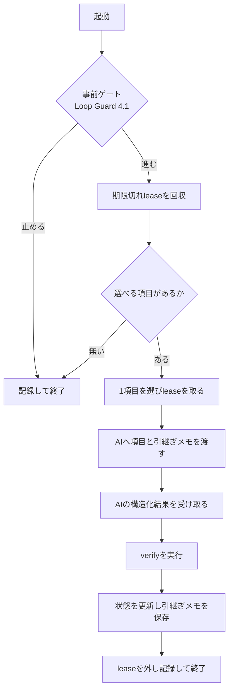

# Loop State Handoff

## 1. 目的と適用範囲

本規約は、定期・反復実行するループが、ある回から次の回へ作業の状態を引き継ぐ方法を定める。会話の履歴には頼らない。決まった形式のファイルで受け渡し、1回の起動では1項目だけを処理する。

成功の判定、予算、止まる条件は[Loop Guard Policy](loop-guard-policy.md)を正本とする。本規約はその前提となる「何を処理するか」と「どこまで進んだか」を扱う。人間承認の扱いは[Human Gate Policy](human-gate-policy.md)に従う。

適用対象は、バックログやボードから項目を選んで進める無人ループである。開発サイクル、改善提案の起票、定期的な棚卸しを含む。

## 2. 観測した問題

[Loop Guard Policy](loop-guard-policy.md)と同じ個人環境の定期実行基盤について、開発サイクル型ジョブの指示文と実行記録を2026-11-15に確認した。

| 観測 | 内容 |
|---|---|
| 同じジョブの実行期間が重なった | 1,204件のうち37件が、同じジョブの前回の実行が終わる前に始まっていた。5本のジョブで起きている |
| lockの有効期限がジョブごとに違う | ある指示は「50分以内に作られたlockがあれば終了」、別の指示は「170分以内かつセッション生存」。実行は最長約6時間続いており、どちらの期限も超えていた |
| 状態ファイルの形式がジョブごとに違う | `sprint.json`、`board.json`、`product-backlog.json`、ログ用のMarkdownが、ジョブごとに別の項目名と状態名で書かれている |
| 状態をAIが書き換えている | 「受入条件を満たせば`sprint.json`の該当項目を`done`にする」など、完了判定と状態更新をAIへの指示で行っている |
| 「1回1項目」が一部のジョブにしかない | 1回に1項目だけ扱う規則を明記したジョブと、未着手の項目をまとめて委譲するジョブが混在している |

ここから次の3つが分かる。

- **重複実行を防げていない。** lockの期限が実行時間より短いため、前回の実行が動いたまま次の回が同じ項目に着手できる。
- **状態の正しさを保証できない。** AIが自分の結果を自分で`done`にしており、検証を経ずに状態が進む。複数の実行が同じファイルを書けば、更新が失われる。
- **ジョブをまたいだ集計ができない。** 形式がばらばらなので、どのジョブで何件が詰まっているかを横断して見られない。

## 3. 原則

1. **状態を書くのはスクリプトだけ。** AIは状態ファイルを読みも書きもしない。スクリプトが選んだ1項目と引継ぎメモだけを受け取り、構造化した結果を返す。
2. **1回の起動で1項目。** 項目は1回で終わる大きさに切る。終わらない項目は分割を提案して終える。
3. **項目ごとにleaseを取る。** ジョブ全体のlockに加え、処理中の項目にはleaseを付ける。leaseの期限は実行時間の上限より長くする。
4. **状態は検証の結果で進める。** 項目を`done`にできるのは、[Loop Guard Policy](loop-guard-policy.md)の`VERIFIED`が出たときだけとする。
5. **引き継ぐのは要約だけ。** 次の回に渡すのは項目ごとの短い引継ぎメモであり、ログ全体や会話の履歴は渡さない。

## 4. ファイル構成

ループごとに1つの状態ディレクトリを持つ。

```text
loop-state/<loop-id>/
├── backlog.json        # 項目の一覧と状態（スクリプトだけが書く）
├── handoff/<item-id>.md  # 項目ごとの引継ぎメモ（AIの出力をスクリプトが保存する）
├── runs.jsonl          # 実行記録（Loop Guard Policy 5章の形式。追記のみ）
└── lock                # ジョブ単位のlock
```

人間が読むための一覧（Markdownの表など）が必要なら、`backlog.json`からスクリプトで生成する。生成物を手で編集しない。

## 5. 項目と状態

### 5.1 項目の形式

```json
{
  "id": "item-042",
  "title": "設定画面の保存処理を共通化する",
  "status": "todo",
  "priority": 2,
  "depends_on": ["item-039"],
  "acceptance": ["npm test が通る", "保存処理が1か所にまとまっている"],
  "verify": ["npm test", "npm run typecheck"],
  "attempts": 0,
  "lease": null,
  "source": "human",
  "updated_at": "2026-11-15T09:17:01Z"
}
```

- `acceptance`は人間が読む受入条件、`verify`はスクリプトが実行する検証commandである。`verify`が空の項目は自動では選ばない。
- `source`は項目を誰が起こしたかを表す。`human`または`ai`。

### 5.2 状態の遷移

| 状態 | 意味 | 次に進める条件 |
|---|---|---|
| `proposed` | AIが起こした提案。まだ着手できない | 人間が`todo`へ上げる |
| `todo` | 着手できる | スクリプトが選んでleaseを取ると`in_progress` |
| `in_progress` | leaseを持つ実行が処理中 | 検証の結果で`done`・`todo`・`blocked`のいずれかへ |
| `done` | `VERIFIED`で完了した | なし |
| `blocked` | 再試行しても通らない、または人間の判断が必要 | 人間が理由を確認して`todo`へ戻す |

- `attempts`は項目を選んでleaseを取るたびに1増やす。
- `in_progress`の項目は、結果が`VERIFIED`なら`done`にする。`FAILED`で`attempts`が1以下なら`todo`に戻し、2に達したら`blocked`にする。
- `TIMED_OUT`などで実行が途中で終わった項目は、leaseの期限が切れた時点で`todo`に戻す。`attempts`が2に達していれば`blocked`にする。
- AIが起こした項目は必ず`proposed`から始める。AIが自分で`todo`にすることはない。1日に起こせる提案の上限を設定で決める。

## 6. 1回の流れ



### 6.1 項目の選び方

スクリプトが次の順で決める。モデルに選ばせない。

1. `status`が`todo`である
2. `depends_on`がすべて`done`である
3. `verify`が空でない
4. `priority`が高い順、同じなら`updated_at`が古い順

### 6.2 lease

- leaseは`{run_id, expires_at}`を項目に書き込むことで取る。`expires_at`は[Loop Guard Policy](loop-guard-policy.md)4.2の実行時間の上限より長くする。
- 書き込みは一時ファイルへ書いてからrenameで置き換え、途中の状態を残さない。
- 起動のたびに、期限が切れたleaseを持つ`in_progress`項目を`todo`に戻す。
- ジョブ単位のlockも併用し、lockの期限も同じ上限から決める。ジョブごとに別の数字を書かない。

### 6.3 AIへ渡すものと返させるもの

AIへの入力は次の3つだけにする。

- 対象の項目（`id`、`title`、`acceptance`）
- その項目の引継ぎメモ（前回の試行があれば）
- 前回の検証に落ちた場合は、その出力

AIには次の形の結果を返させ、`--json-schema`で形式を固定する。

```json
{
  "item_id": "item-042",
  "summary": "保存処理を store/save.ts にまとめた",
  "handoff": "残りは設定画面のテスト追加。save.ts のエラー処理は既存挙動に合わせた",
  "split_proposal": [],
  "new_proposals": []
}
```

- `handoff`は次の回にそのまま渡す。長さに上限を設け、超えたらスクリプトが`FAILED`にする。
- `split_proposal`と`new_proposals`は`proposed`として`backlog.json`に追加する。
- 結果に`status`の欄は持たせない。状態はスクリプトが`verify`の結果から決める。

## 7. 人間とのやりとり

- 人間は`backlog.json`に項目を足し、`proposed`を`todo`へ上げ、`blocked`の理由を見て`todo`へ戻す。これらの操作もスクリプトのコマンド経由で行い、ファイルを直接編集しない。
- `blocked`と`proposed`の件数は、[Loop Guard Policy](loop-guard-policy.md)6章の指標と一緒に週次で見る。

## 8. 既存ハーネスとの関係

- [Scheduled Refactoring Harness](claude-code-scheduled-refactoring-harness/README.md)は、Jiraチケットを作業源とし、選択・状態遷移をスクリプトが行う。本規約は、Jiraを使わないループで同じ分担を取るための最小形である。
- [Claude Code Development Harness](claude-code-development-harness/README.md)の永続progress・handoffは、人間が同席する複数セッションの開発を対象とする。本規約は無人ループに限り、引継ぎを項目単位の短いメモに絞る。

## 9. 段階導入

1. **形式の統一**: 既存の状態ファイルを本規約の`backlog.json`へ変換するスクリプトを作り、読み取りだけで運用を始める。
2. **lockとleaseの統一**: lockとleaseの期限を実行時間の上限から決め、重複実行が0件になることを記録で確認する。
3. **書き込みの移管**: AIへの指示から状態更新の手順を消し、スクリプトが`verify`の結果で状態を進めるようにする。
4. **1回1項目の徹底**: まとめて委譲していたジョブも、1回1項目に切り替える。
